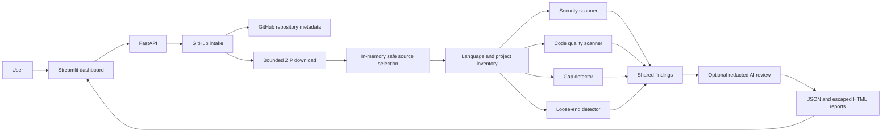

# CodeSentinel

CodeSentinel is a read-only, architecture-agnostic code auditing demo for public GitHub repositories. It combines bounded repository intake with static checks for common security patterns, unfinished implementations, measurable duplication/complexity, and maintainability loose ends. A Streamlit dashboard presents the results and exports JSON or HTML reports.

## Problem

A repository can contain risky patterns, incomplete work, or avoidable maintenance issues that are easy to miss in a quick review. Many audit tools are language- or framework-specific, and an AI-only review can be expensive, opaque, or overconfident.

## Proposed Solution

CodeSentinel uses independent static scanners that emit a shared finding model. Static analysis works without an API key. An optional OpenAI-compatible reviewer can refine explanations and connect overlapping findings, but it cannot add findings or alter their severity. Findings are signals to verify, not proof of exploitability.

## Architecture



### Modules

- `codesentinel/github_handler.py`: validates canonical public GitHub URLs, downloads repository metadata and a ZIP archive over HTTPS, and scans it without extracting files. Enforces file-count, byte, per-file, and line limits; excludes generated/vendor folders and unsafe paths.
- `codesentinel/repository_analyzer.py`: builds the source-file inventory and detects common tests, documentation, dependency manifests, and configuration files.
- `codesentinel/security_scanner.py`: checks secret-like assignments/tokens, SQL interpolation, shell invocation, and selected unsafe API/configuration patterns. Runs Bandit when its CLI is installed.
- `codesentinel/slop_detector.py`: detects duplicate import statements, repeated four-line blocks, and Python functions with high estimated branch complexity. It does not infer AI authorship.
- `codesentinel/gap_detector.py`: finds TODO/FIXME markers, empty concrete Python functions, `NotImplementedError`, and common not-implemented messages. Abstract methods and Python `Protocol` methods are exempted from empty-body findings.
- `codesentinel/loose_ends_detector.py`: reports conservative Python unused-import/local-name and bare-except signals, plus informational repository-level test/documentation/dependency-manifest signals.
- `codesentinel/ai_reviewer.py`: optionally sends only bounded, redacted excerpts around existing findings to an OpenAI-compatible endpoint. It never receives the full repository by design. Static results remain available on provider errors.
- `codesentinel/report_generator.py`: orders findings, computes severity counts and a documented heuristic score, serializes JSON, and renders escaped HTML.
- `codesentinel/analysis_service.py`: coordinates independent scanners.
- `codesentinel/main.py`: exposes the FastAPI health and analysis endpoints.
- `frontend/app.py`: Streamlit dashboard with repository summary, category tabs, issue details, and report downloads.
- `run.py`: starts API and dashboard processes for local use.

## Features

- Public GitHub URL validation and graceful errors for unavailable, private, or rate-limited repositories.
- Language inventory for Python, Java, JavaScript, TypeScript, C/C++, C#, Go, Rust, Ruby, PHP, Swift, Kotlin, Scala, Shell, SQL, HTML/CSS, JSON, YAML, and other listed extensions.
- No checkout, extraction, build, import, or execution of repository code.
- Severity-ranked findings with file, line, explanation, confidence, and suggested fix.
- Optional Bandit scan for Python when installed.
- Optional AI review; no AI credentials are required for static analysis.
- JSON and standalone HTML downloads.
- A deterministic heuristic score with its formula shown in the report. It is not a security certification.

## Technology Stack

- Python 3.10+
- FastAPI and Pydantic
- Streamlit
- Bandit (optional at runtime)
- Python standard library for URL validation, ZIP inspection, AST analysis, and report serialization
- `unittest` for tests

## Installation

From the repository root, create and activate a virtual environment:

```powershell
py -3.10 -m venv .venv
.\.venv\Scripts\Activate.ps1
python -m pip install --upgrade pip
python -m pip install -r requirements.txt
```

On macOS/Linux, activate with `source .venv/bin/activate` instead. Copy `.env.example` to `.env` only if you need custom settings or optional AI review. Keep `.env` private; it is ignored by Git.

## Configuration

- `CODESENTINEL_AI_API_KEY`: optional provider key. Leave blank for static-only analysis.
- `CODESENTINEL_AI_BASE_URL`: optional OpenAI-compatible base URL, HTTPS required except for a loopback development endpoint.
- `CODESENTINEL_AI_MODEL`: model name understood by the configured endpoint.
- `CODESENTINEL_API_HOST` / `CODESENTINEL_API_PORT`: API bind address and port (defaults to loopback and 8000).
- `CODESENTINEL_UI_HOST` / `CODESENTINEL_UI_PORT`: dashboard bind address and port (defaults to loopback and 8501).
- `CODESENTINEL_API_URL`: dashboard API URL. The launcher derives a local URL when this is not set.

Do not bind the unauthenticated API to a public interface. If remote access is needed, put it behind an authenticated, TLS-terminating proxy. The optional AI provider receives finding metadata and small, redacted source excerpts; do not enable it for repositories you are not permitted to share with that provider.

## Run the Application

```powershell
python run.py
```

Open <http://127.0.0.1:8501>. The API health check is at <http://127.0.0.1:8000/health>; interactive API documentation is at <http://127.0.0.1:8000/docs>. Stop both local processes with Ctrl+C in the launcher terminal.

To run only the API:

```powershell
python -m uvicorn codesentinel.main:app --host 127.0.0.1 --port 8000
```

## Analyze a Repository

1. Open the dashboard and enter a public repository URL such as `https://github.com/owner/repository`.
2. Select **Analyze repository** and wait for download and static checks to complete.
3. Review languages, file counts, severity totals, and each finding in its category tab.
4. Download the JSON or HTML report for sharing or follow-up.

The intake downloads a ZIP from GitHub over HTTPS, does not extract it to disk, and does not execute repository code. Repositories are limited to a 20 MB archive, 15 MB of source, 8,000 relevant files, 1 MB per file, 250,000 source lines total, and 50,000 lines per source file. Generated and vendor directories such as `.git`, `node_modules`, `venv`, `dist`, `build`, and `__pycache__` are ignored. GitHub unauthenticated API rate limits may apply.

## Example Output

An illustrative finding shape (not a result for any particular repository):

```json
{
  "rule_id": "SEC-SQL-FSTRING",
  "category": "security",
  "severity": "High",
  "title": "Potential SQL injection through an interpolated query",
  "file": "src/accounts.py",
  "line": 42,
  "explanation": "This source pattern may combine an externally influenced value with a sensitive operation. Data flow is not proven by this check.",
  "recommendation": "Use a parameterized query and validate inputs.",
  "confidence": "medium"
}
```

## Tests

Tests use local fixtures and do not require GitHub access or an AI service:

```powershell
python -m unittest discover -v
```

The fixtures cover hardcoded secrets, SQL interpolation, shell invocation, a clean parameterized query, empty functions, TODO/FIXME markers, abstract-method exemptions, duplicate code/imports, unused names, bare exception handling, repository URL validation, ignored directories, report escaping, and AI request/response redaction.

## Limitations

- Pattern-based checks cannot prove data flow, reachability, exploitability, authentication correctness, or business-logic completeness. Findings may be false positives or misses; no static analyzer can certify a repository as secure.
- Security patterns are broad but not equally precise across every language. Bandit adds Python checks only when installed; richer language-specific tools such as Semgrep are not currently integrated.
- Unused-name detection is limited to Python and can be confused by dynamic imports, reflection, decorators, plugin registration, or framework conventions. Test-file detection is naming-based and does not measure coverage.
- Duplicate code uses normalized exact four-line blocks; it does not perform semantic clone analysis. Complexity estimates cover Python only.
- Common secret patterns are redacted before optional AI review, but no secret scanner can recognize every credential format. AI use is opt-in; review your data-sharing policy before configuration.
- GitHub public API limits, network availability, and configured archive limits can prevent analysis. Large repositories may be rejected or partially skipped.
- The health score is a simple prioritization heuristic based on finding counts, not a standardized quality measure.

## Future Enhancements

- Integrate Semgrep and language-specific analyzers behind optional adapters.
- Add SARIF output, reusable scan profiles, and a diff-aware pull request mode.
- Improve data-flow analysis and language-specific unused symbol detection.
- Add authenticated job queues and persistent report history for hosted deployments.
- Add explicit per-language parser and integration-test coverage.
